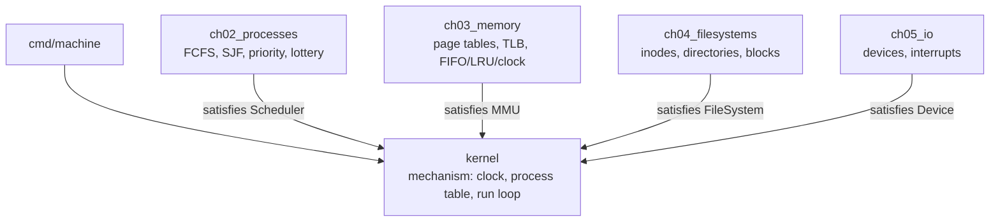
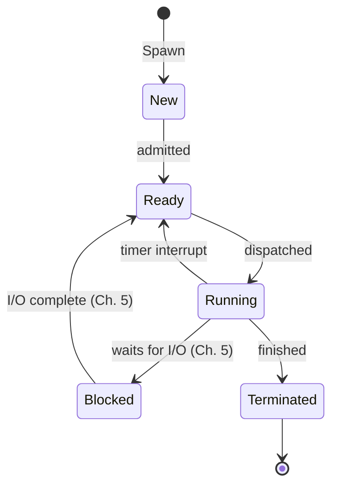
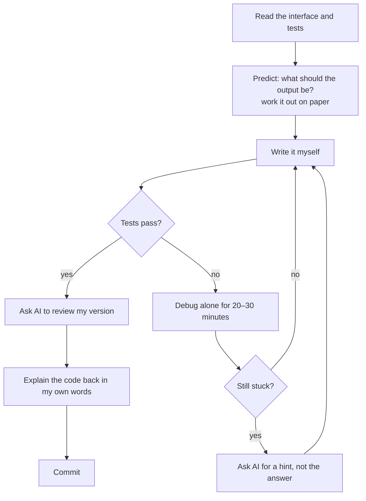

# oslab

**Learning operating systems by building one, in Go.**

`oslab` is my companion project for *Modern Operating Systems* (Tanenbaum & Bos, 5th edition), with gaps filled in from *Operating Systems: Three Easy Pieces* (OSTEP). Every chapter becomes Go code in two forms: **labs** that poke the real macOS kernel, and a **simulated machine** (`kernel/`) that I grow chapter by chapter until it has a scheduler, virtual memory, a file system, devices and deadlock detection, all running together. The capstone is a **mini container runtime**, the same idea that Docker and Kubernetes are built on.

This README explains what the project is, why it's built this way, why it's in Go, how it builds my programming skills, and the specific rules I follow for using AI so it speeds up my learning without doing the learning for me.

---

## Contents

1. [Why this project exists](#why-this-project-exists)
2. [Why Go](#why-go)
3. [How the project is built](#how-the-project-is-built)
4. [The learning loop](#the-learning-loop-for-every-chapter)
5. [Roadmap](#roadmap)
6. [How this makes me a better programmer](#how-this-makes-me-a-better-programmer)
7. [How I use AI, and how I keep it from hurting my learning](#how-i-use-ai-and-how-i-keep-it-from-hurting-my-learning)
8. [Running it](#running-it)
9. [Progress](#progress)

---

## Why this project exists

I'm building toward Go backend engineering and MLOps: the systems that take AI models and run them reliably in production. That work sits directly on top of the operating system. A model server is processes, threads, memory limits, file descriptors, sockets and containers. When it's slow or crashes, the answer is almost always in one of those layers.

Reading an OS book alone doesn't stick. Concepts like page replacement or scheduling only become real once I've implemented them, measured them and broken them. So the rule for this repo is: **every concept I read about, I build or observe in code.**

An operating system does two jobs, and every chapter is one of them applied to a resource:

| Job | Meaning | Examples in this repo |
|---|---|---|
| **Extended machine** | Hide ugly hardware behind clean abstractions | processes instead of a raw CPU, files instead of disk blocks |
| **Resource manager** | Share the CPU, memory and disk fairly and efficiently | schedulers, page replacement, I/O queues, deadlock detection |

---

## Why Go

I chose Go as the main language for my backend track, and it turns out to be a strong language for learning operating systems too.

**It's the language of the infrastructure I want to work on.** Docker, Kubernetes, containerd, etcd and Prometheus are all written in Go. Learning OS concepts in the same language those tools use means I can eventually read their source and recognize what I learned here.

**It's close enough to the system to be honest.** Go compiles to a native binary, has real pointers, exposes system calls through `syscall` and `golang.org/x/sys`, and lets me control memory layout with structs. I can see system calls happen instead of having them hidden behind a virtual machine.

**It's safe enough to learn without fighting the language.** Garbage collection and bounds checking mean my bugs are logic bugs, not memory corruption. In an OS course that matters: I want to spend my time on why LRU beats FIFO, not on a segfault from a dangling pointer.

**Its runtime is a small operating system.** Go's runtime contains a scheduler (goroutines on OS threads, the M:N model from Chapter 2), a memory allocator and garbage collector (Chapter 3), and a network poller (Chapter 5). Studying the OS teaches me Go, and studying Go teaches me the OS.

**The tooling teaches correctness.** `go test`, table-driven tests, benchmarks, the race detector (`-race`) and `pprof` are built in. The race detector alone makes Chapter 2's concurrency theory something I can watch fail and then fix.

**Why not C?** C is the traditional OS language, and real kernels are written in it. But my goal is understanding OS concepts and becoming a strong Go backend engineer, not writing a bootable kernel. A simulated machine in Go teaches the same mechanisms (scheduling, paging, file systems) without weeks spent on bootloaders and toolchains, and every hour of practice also counts toward my main language.

---

## How the project is built

### Two kinds of code

| | **Labs** (`chXX_*/`) | **The Machine** (`kernel/`) |
|---|---|---|
| What it is | Go talking to the *real* macOS kernel | A *simulated* computer I build myself |
| Example | `syscall.Write`, spawning real processes, watching the GC | my own scheduler, page tables, file system |
| Teaches | **What** the OS does for me | **How** the OS does it |
| Lifespan | One per chapter | Grows every chapter into the final project |

I can't replace macOS's scheduler, but I can build one inside a simulation where I control the clock and every decision is logged. The labs keep me connected to reality, and the Machine is where the mechanisms get built.

### Layout

```
oslab/
├── go.mod
├── README.md
├── kernel/                 THE MACHINE: grows every chapter
│   ├── kernel.go           clock, process table, run loop
│   ├── rr.go               reference round-robin scheduler
│   └── kernel_test.go
├── ch01_intro/             lab: system calls, real processes
│   └── NOTES.md
├── ch02_processes/         lab + schedulers that plug into kernel
│   └── NOTES.md
├── ...
└── cmd/
    ├── machine/            boots the simulated computer
    ├── ch01/               one runnable demo per chapter
    └── ch02/
```

### The core design rule: policy vs. mechanism

The kernel owns the **mechanism**: the clock, the process table, the run loop, and *when* things happen. Chapters provide the **policy**: *how* each decision is made. The kernel defines an interface for each subsystem, and each chapter writes types that satisfy it.



Two rules keep the design clean:

- **Dependencies point one way.** Chapters import `kernel`; `kernel` never imports a chapter. If the kernel seems to need to know about one specific policy, the interface is missing a method.
- **Earlier chapters keep working.** Adding a subsystem must not break the ones before it. Old tests passing is how I know the design held.

Swapping a policy is one line:

```go
m := kernel.Boot(&ch02.SJF{})   // try a different scheduler
m.Mem = &ch03.LRUPager{}        // try a different page replacement policy
```

### Simulated time

The Machine runs on **ticks**, an integer clock, instead of real time. Nothing is random unless I seed it, so every run produces the identical trace. That makes the Machine testable: every expected value in a test is one I can work out by hand on paper.

### Process states



---

## The learning loop for every chapter


1. **Read first.** The book section comes before any code or AI explanation, so I have my own first impression to compare against.
2. **Theory.** Work through the concepts until I can explain them without notes. OSTEP fills the places where MOS is thin.
3. **Lab.** See the concept on the real OS: real system calls, real processes, real goroutines.
4. **Machine.** Build the mechanism into the simulator through the chapter's interface.
5. **Break it.** Remove a lock and watch the race detector, cause a deadlock, starve a process, thrash memory. Knowing how something fails is part of understanding it.
6. **Notes.** Each chapter's `NOTES.md` holds only the key points, a diagram, and the mistakes I made. Short enough to review in five minutes.

---

## Roadmap

| Ch | Topic | Lab (real macOS) | Machine piece | Go skills practiced |
|---|---|---|---|---|
| 0 | Project core | — | clock, PCB, run loop | named types, `iota`, interfaces, pointer receivers |
| 1 | Introduction | syscalls, user vs kernel mode | — | `syscall`, `os`, benchmarks |
| 2 | Processes & threads | real processes, goroutines, locks | `Scheduler` | goroutines, `sync`, channels, `-race` |
| 3 | Memory management | Go's allocator and GC | `MMU`: paging, TLB, replacement | slices, maps, `runtime`, `pprof` |
| 4 | File systems | `fsync`, file descriptors | `FileSystem`: inodes, blocks | `io` interfaces, `encoding/binary` |
| 5 | Input/output | buffering, Go's netpoller | `Device`: interrupts, Blocked state | `bufio`, `net`, `context` |
| 6 | Deadlocks | deadlocking goroutines | deadlock detector | graphs, cycle detection |
| 7 | Virtualization & cloud | — | **Capstone: mini container runtime** (Linux VM) | namespaces, cgroups, `os/exec` |
| 8 | Multiprocessors | `GOMAXPROCS`, false sharing | multi-CPU scheduling | `sync/atomic`, cache-aware structs |
| 9 | Security | least privilege | permission checks | file modes, capabilities |
| 10–12 | Case studies, OS design | skim | — | — |

**Environment note:** I develop on macOS (Apple Silicon), so labs avoid Linux-only tools such as `strace`. The capstone needs Linux namespaces and cgroups, so it runs inside a Linux VM.

---

## How this makes me a better programmer

This project isn't just OS trivia. Each chapter maps onto problems I'll face as a backend and MLOps engineer:

| OS concept | Where it shows up in backend and MLOps work |
|---|---|
| Scheduling, time slices, starvation | worker pools, request queues, fair-share limits, Kubernetes pod scheduling |
| Turnaround and response time | latency vs. throughput tradeoffs, p99 latency |
| Race conditions, locks, semaphores | shared caches, connection pools, counters under concurrent load |
| Page replacement (LRU, clock) | in-memory caches, model caching when GPU memory is limited |
| Virtual memory, working sets | why a service gets OOM-killed, container memory limits |
| `fsync`, journaling | durability in databases and message queues; what "committed" really means |
| I/O buffering, event loops | why Go's `net/http` handles thousands of connections, backpressure |
| Deadlock conditions | debugging services that hang, lock ordering, timeouts with `context` |
| Namespaces, cgroups | exactly what Docker and Kubernetes do; foundation for CKAD |

Beyond the topics, the project trains habits:

- **Debugging from first principles.** When something is slow or broken, I'll know which layer to check instead of guessing.
- **Reading and designing interfaces.** The whole Machine is interface design, the most important skill in idiomatic Go.
- **Testing like an engineer.** Hand-derived expected values, table-driven tests, the race detector and benchmarks become reflexes.
- **Thinking in tradeoffs.** Every chapter has a "no free lunch" decision (fairness vs. throughput, memory vs. speed, safety vs. performance). That's the same reasoning system design interviews test.
- **A real portfolio piece.** A simulated OS plus a container runtime shows depth that tutorial projects don't.

---

## How I use AI, and how I keep it from hurting my learning

AI is a powerful tutor, and a dangerous one. It can explain anything instantly, which is valuable. It can also write code I never understood, which makes me feel productive while I learn nothing. The research on learning is clear on why this matters: understanding comes from **retrieval** (pulling knowledge out of my own head) and **effortful struggle**, not from reading correct answers. So AI is allowed to make learning faster, but never to make it easier in the way that skips the struggle.

### The core rule

> **AI explains and checks. I build.**
> If I can't rewrite it from a blank file without looking, I don't understand it yet.

### What AI is used for

| Use | Why it helps |
|---|---|
| **Explaining theory** in a second way after I've read the book | A different explanation often makes a concept click |
| **Building the scaffolding:** project structure, the kernel core, reference implementations | Gets me to the real learning faster. Reference code is something to study, not to keep without understanding |
| **Line-by-line explanations** of code I'm studying | Turns reading code into learning from it |
| **Generating experiments** ("how could I break this?") | Finds failure modes I wouldn't think of |
| **Reviewing my code** after I've written it | Catches bugs and unidiomatic Go, like a senior engineer would |
| **Decoding error messages** after I've tried to understand them myself | Saves time on unfamiliar tooling |
| **Quizzing me** on a chapter | Retrieval practice, the most effective study method |

### What AI is not used for

- **Writing the chapter implementations.** The schedulers, the page replacement policies, the file system: I write those myself from the interface and the tests.
- **Answering before I've tried.** I attempt every problem first.
- **Replacing the book.** AI explanations supplement MOS and OSTEP; they don't replace reading them.
- **Copy-pasting code into the repo.** Any code that comes from AI gets typed out by hand and explained back before it's committed.

### The workflow for each implementation



### The hint ladder

When I'm stuck, I ask for the smallest amount of help that unblocks me, in this order:

1. **"What concept am I missing?"** Point me to the idea, not the code.
2. **"Where in my code is the problem?"** Name the function or line, not the fix.
3. **"Give me a hint for the fix."** One sentence of direction.
4. **"Show me a minimal example of the pattern"**, on a different problem, not mine.
5. **Full solution**, only as a last resort, and then I delete it and rewrite it from memory the next day.

### Checks that keep me honest

- **Predict before running.** Before every `go run` or `go test`, I write down what I expect. A wrong prediction is the most valuable moment in the session, because it marks exactly what I didn't understand.
- **Explain it back.** After each chapter, I explain the main mechanism out loud or in `NOTES.md` without looking at code. If I can't, I'm not done.
- **Blank-file test.** Before moving to the next chapter, I rebuild one key piece (for example, round robin or LRU) from an empty file without AI or notes.
- **Verify AI against sources.** AI can be confidently wrong. Claims about OS behavior get checked against MOS, OSTEP or the Go docs, and errors I catch go in `NOTES.md`.
- **Label what came from AI.** Commits that include AI-provided reference code say so in the commit message, so the history shows what I wrote versus what I studied.

### Why this balance matters

The goal is to become an engineer who can **catch** AI when it's subtly wrong, not one who depends on it. That's the job companies actually need done: someone who understands the system well enough to own the result. Every rule above exists to protect that.

---

## Running it

Requirements: Go (any recent version). No Linux needed until the Chapter 7 capstone.

```bash
git clone <this repo>
cd oslab

go test ./...            # run every test
go test -race ./...      # run tests with the race detector
go run ./cmd/machine     # boot the simulated machine and print its trace
go run ./cmd/ch01        # run a chapter's demo
```

Example output from `go run ./cmd/machine` (round robin, quantum 2):

```
pid  name      turnaround
  1  shell     7
  2  editor    11
  3  compiler  9
```

---

## Progress

| Part | Topic | Lab | Machine | Notes |
|---|---|---|---|---|
| 0 | Project core | — | ✅ | ✅ |
| 1 | Introduction | ⬜ | — | ⬜ |
| 2 | Processes & threads | ⬜ | ⬜ | ⬜ |
| 3 | Memory management | ⬜ | ⬜ | ⬜ |
| 4 | File systems | ⬜ | ⬜ | ⬜ |
| 5 | Input/output | ⬜ | ⬜ | ⬜ |
| 6 | Deadlocks | ⬜ | ⬜ | ⬜ |
| 7 | Virtualization (capstone) | — | ⬜ | ⬜ |
| 8 | Multiprocessors | ⬜ | ⬜ | ⬜ |
| 9 | Security | ⬜ | ⬜ | ⬜ |

---

## References

- Andrew S. Tanenbaum & Herbert Bos, *Modern Operating Systems*, 5th edition (primary text)
- Remzi & Andrea Arpaci-Dusseau, *Operating Systems: Three Easy Pieces*, [ostep.org](https://pages.cs.wisc.edu/~remzi/OSTEP/) (gap-filler)
- [The Go Programming Language documentation](https://go.dev/doc/)
- [Go memory model](https://go.dev/ref/mem)
